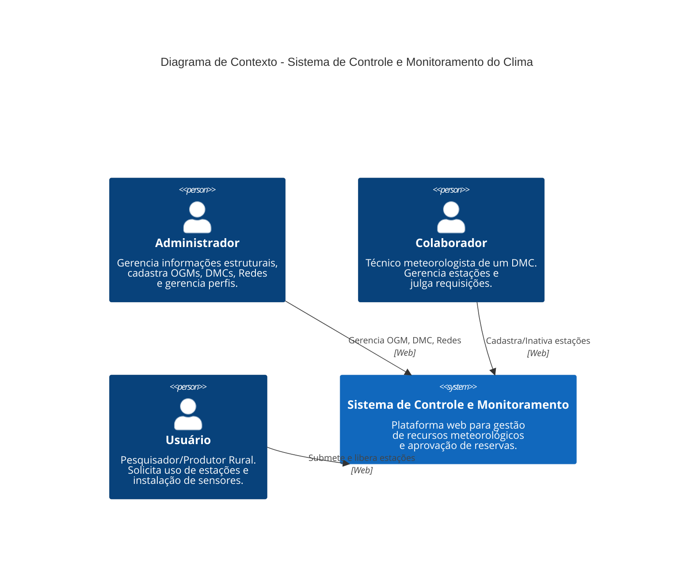
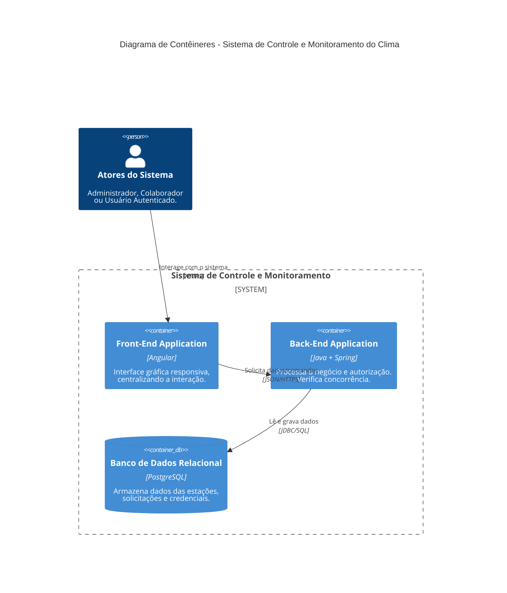
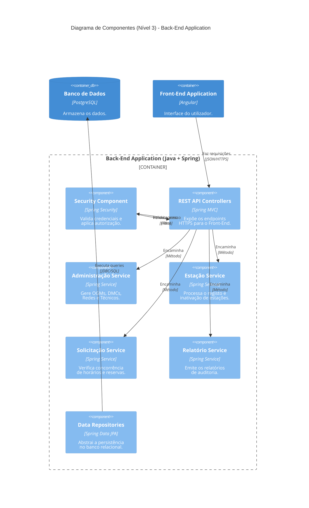

# TEDUND1BESMATT2GR1_BACK
Official repositotry involving the backend from SWA project, using JPA.

### Nível 1: Diagrama de Contexto

### Nível 2: Diagrama de Contêineres

### Nível 3: Diagrama de Componentes (Back-End)

