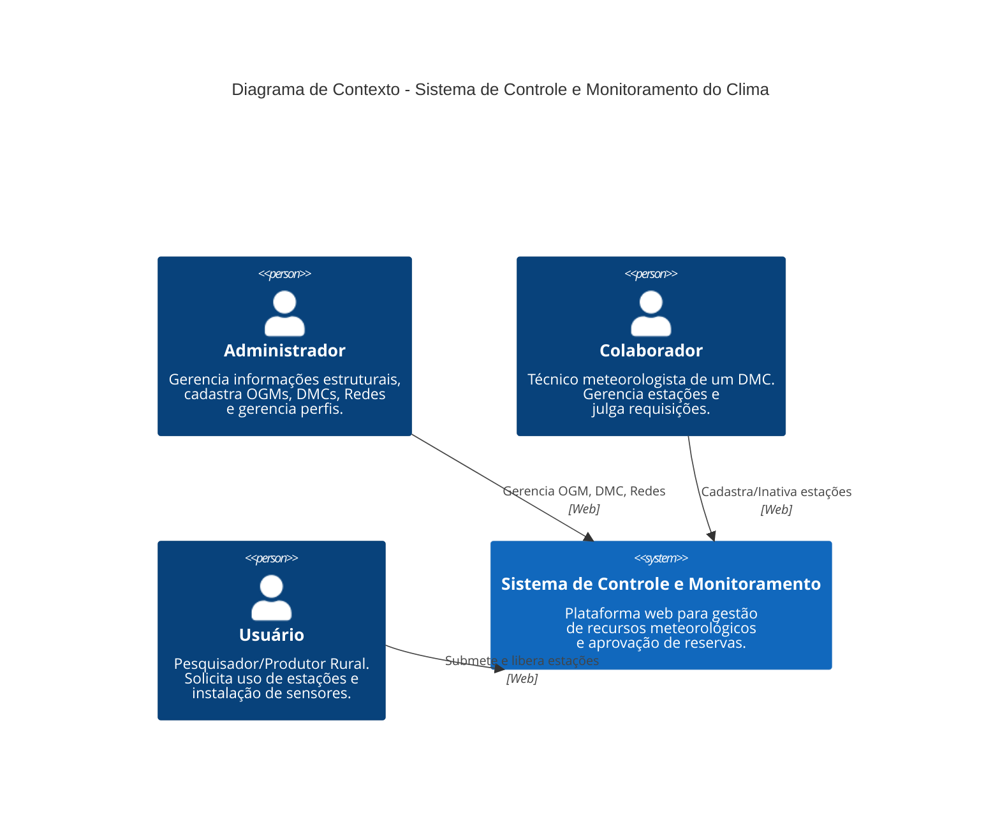
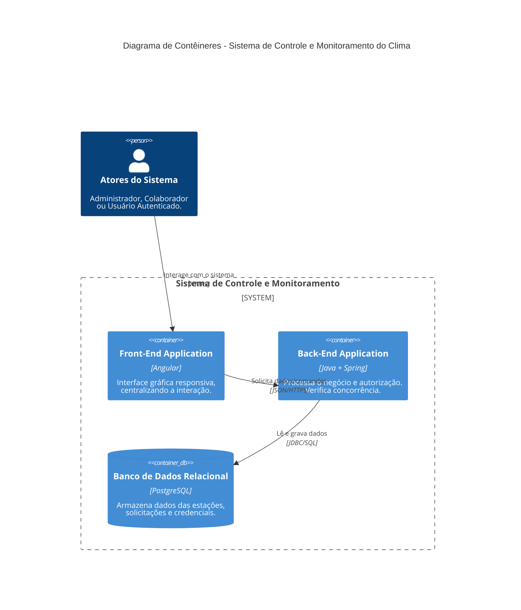
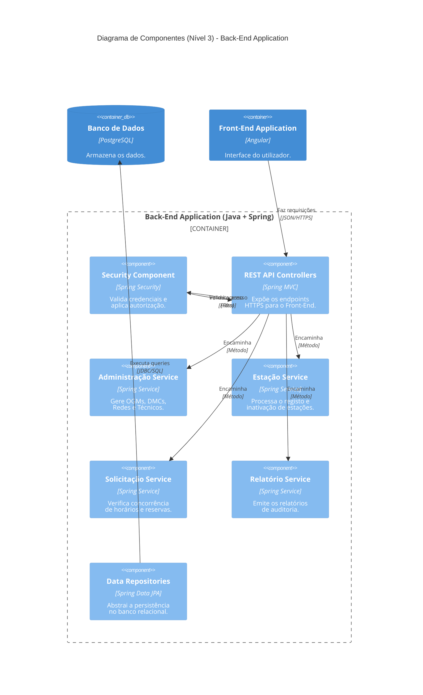

# Sistema de Controle e Monitoramento do Clima - Back-End

Base em Java 17, Spring Boot 3, Spring Security, JPA e PostgreSQL. Este primeiro incremento entrega o modelo de dados, repositórios e autenticação; os módulos operacionais serão adicionados nos próximos incrementos.

## Arquitetura C4

### Nível 1: Diagrama de Contexto


### Nível 2: Diagrama de Contêineres


### Nível 3: Diagrama de Componentes (Back-End)


## Pré-requisitos

- JDK 17 ou superior e Maven 3.9+
- PostgreSQL com um banco vazio criado para a aplicação

## Configuração local

As propriedades ficam em `src/main/resources/application.properties`. Por padrão, a aplicação tenta `jdbc:postgresql://localhost:5432/clima` com usuário e senha `postgres`. Configure o ambiente se a instância for diferente:

| Variável | Finalidade |
| --- | --- |
| `DB_URL` | URL JDBC do banco PostgreSQL |
| `DB_USERNAME` / `DB_PASSWORD` | Credenciais usadas somente pelo Back-End |
| `SERVER_ADDRESS` | Endereço da API; padrão `127.0.0.1` para acesso local |
| `JWT_SECRET` | Segredo de assinatura com pelo menos 32 bytes |
| `JWT_EXPIRATION_MS` | Duração do token; padrão 1 hora |
| `FRONTEND_ORIGIN` | Origem Angular aceita pelo CORS; padrão `http://localhost:4200` |
| `SEED_PASSWORD` | Senha inicial das contas de teste; padrão `123456` |
| `SEED_ENABLED` | `false` para desativar as contas de teste |

Execute `mvn spring-boot:run`. O Hibernate usa `spring.jpa.hibernate.ddl-auto=update`, como exigido para a entrega, e cria/atualiza as tabelas no banco configurado.

Para a instância local `clima_db` na porta 5436, configure `DB_URL=jdbc:postgresql://localhost:5436/clima_db` antes de iniciar. A senha configurada no pgAdmin deve ser fornecida por `DB_PASSWORD`.

## Autenticação

`POST /api/auth/login` recebe `email` e `senha` e retorna `token`, `nome`, `email` e `perfis`. `GET /api/auth/me` requer `Authorization: Bearer <token>`. Ambos exigem `X-Requested-By: Clima-Angular-SPA`; requisições com header `Origin` só passam se ele corresponder à origem Angular configurada. Requisições preflight válidas são aceitas sem o header customizado.

As contas inseridas na primeira inicialização são `admin@clima.gov.br` (três perfis), `gestor@clima.gov.br` (Administrador), `tecnico@clima.gov.br` (Colaborador) e `pesquisador@clima.gov.br` (Usuário). Todas usam a senha de desenvolvimento `123456`, salvo alteração por `SEED_PASSWORD`. O seeder não redefine contas que já existem. Desative-o e troque o segredo JWT fora do ambiente de desenvolvimento.

Exemplo de verificação no PowerShell:

```powershell
$headers = @{ "X-Requested-By" = "Clima-Angular-SPA" }
$body = @{ email = "admin@clima.gov.br"; senha = "123456" } | ConvertTo-Json
$login = Invoke-RestMethod -Uri "http://localhost:8080/api/auth/login" -Method Post -Headers $headers -ContentType "application/json" -Body $body
$headers.Authorization = "Bearer $($login.token)"
Invoke-RestMethod -Uri "http://localhost:8080/api/auth/me" -Headers $headers
Invoke-RestMethod -Uri "http://localhost:8080/v3/api-docs" -Headers $headers
```

O contrato OpenAPI fica em `/v3/api-docs`. O Swagger UI também está incluído, mas as rotas de documentação exigem o mesmo header e token. O Angular poderá obter o contrato pela API ou pelo proxy autorizado.

O header customizado e o CORS barram navegação direta comum e restringem navegadores. Eles não autenticam a origem: clientes HTTP podem falsificar ambos. A proteção efetiva dos dados depende do JWT, das regras de autorização no Back-End e do isolamento de rede da API e do PostgreSQL no ambiente de execução.
